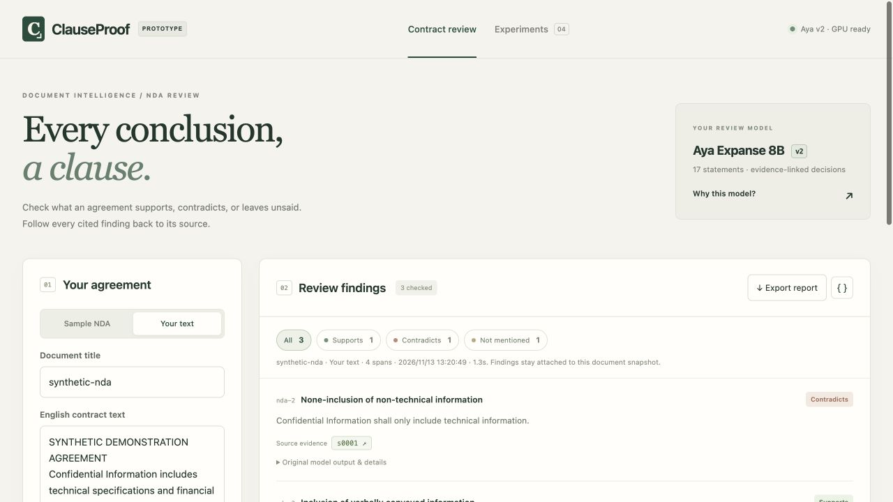
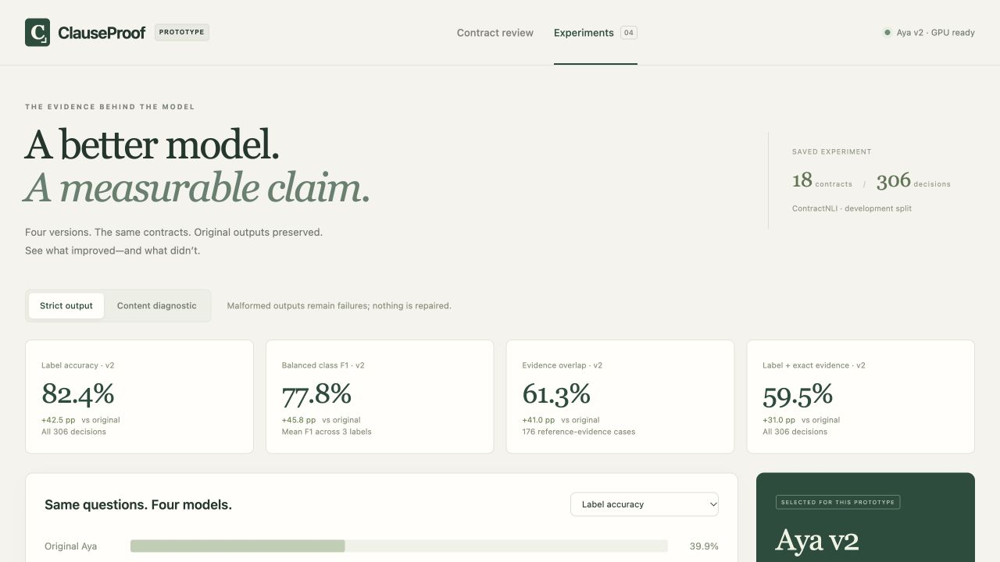

# ClauseProof

**Evidence-linked NDA checking on a single consumer GPU.** Lexsi AI Safety & Alignment Hackathon, Track 1. Built by Yizhong Yan.

ClauseProof checks what an English non-disclosure agreement supports, contradicts, or leaves undecided. It runs **Aya Expanse 8B with the ContractNLI v2 QLoRA adapter**, links each finding to the original source, and exports an immutable source snapshot with the unmodified response. An experiment explorer exposes every saved response from original Aya and adapters v1/v2/v3.

- [Model collection: three public adapters](https://huggingface.co/collections/YYZ0831/clauseproof-aya-expanse-8b-adapters-6af7484d663438f590726683)
- [Data collection: training sets, logs and evaluation](https://huggingface.co/collections/YYZ0831/clauseproof-data-logs-and-evaluation-6af7484eb7bba83ecfafde27)
- [Method and findings](docs/METHOD.md) · [Abstract](docs/ABSTRACT.txt) · [Demo script](docs/DEMO_SCRIPT.txt)



## Try the interface without a GPU

Python 3.11+ and the standard library are enough to explore all saved comparisons:

```sh
git clone https://github.com/Yyz0831/ClauseProof.git
cd ClauseProof
python3 clauseproof/server.py --no-model --port 8791 --run-dir runs/offline-demo
```

Open **http://127.0.0.1:8791**, then choose **Experiments**. Offline mode explicitly disables new reviews; it does not simulate model responses. No account, data download or API key is required to inspect the included 306-case comparison.

## What the tool does

1. Select a public development example, paste an NDA, or import a UTF-8 `.txt` file.
2. Select from the 17 fixed ContractNLI statements and start a review.
3. Inspect **Supports**, **Contradicts**, or **Not mentioned**, plus source-span citations. Not mentioned means insufficient information; it does not imply permission.
4. Click a citation to highlight its original passage. Editing the input cannot change the source attached to an existing result.
5. Export readable HTML or raw JSON, including model provenance. Cancelled and partial runs remain explicitly incomplete.

The live model uses NF4 4-bit weights, BF16 compute and greedy generation, with at most 7,936 input tokens and 256 new tokens. Every selected statement is checked before generation. Overlong text is rejected without truncation. Invalid JSON is preserved as a failure, without schema repair or hidden retries. Custom text uses nonempty lines as spans; public samples retain official span boundaries.

The loopback-only server holds documents/results in RAM, without request-body logging. Jobs expire after 30 minutes; only five are retained. Browser session storage keeps a job ID, not the contract. Explicit exports persist locally. This is a single-user local prototype, not a hosted multi-user service.

## Measured results

All four models use the same prompt and greedy decoding on **18 development contracts / 306 decisions**, including 150 supports, 130 not-mentioned and 26 contradiction cases. Evidence micro F1 is calculated on 176 reference-evidence cases. The other metrics use all 306 decisions.

| Model | Strict format | Label accuracy | Macro F1 | Evidence micro F1 | Label + exact evidence |
|---|---:|---:|---:|---:|---:|
| Original Aya Expanse 8B | 248/306 | 39.87% | 32.00% | 20.26% | 87/306 (28.43%) |
| v1 | 306/306 | 76.80% | 72.52% | 58.72% | 156/306 (50.98%) |
| **v2 — selected** | **306/306** | **82.35%** | **77.82%** | **61.27%** | **182/306 (59.48%)** |
| v3 | 306/306 | 80.07% | 74.34% | 63.57% | 173/306 (56.54%) |

Strict accuracy counts parsing failures as failures. A separate content diagnostic removes one complete Markdown fence: original Aya then reaches **49.35%**, while v2 remains **82.35%**. Thus the strict improvement includes formatting gains, while label improvement remains substantial after this limited normalization. No free-text answer rewriting is involved.

These metrics answer different product questions: schema validity measures whether the UI can consume a response; label accuracy measures the decision; macro F1 gives minority contradictions equal class weight; evidence F1 measures citation coverage; and joint exact success requires both the right decision and the complete official evidence set. Joint scores prevent clean formatting alone from being presented as a successful review.

v3 recognizes 20/26 true contradictions versus v2's 18/26, but false contradiction calls rise from 11 to 24. We select v2 for higher label accuracy and exact joint matches, rather than selecting the newest adapter. The explorer includes regressions as well as improvements.



**These are development results used for model selection, not independent test accuracy.** The official test set was not used for inference or model selection; text hashes were used for deduplication. Questions within one contract are correlated. There is one seed, and data size, balance and optimizer updates change together. The existing one-round AI source review covers 18 selected v2/v3 pairs, not all 306 cases or a legal-expert audit. Span-ID overlap does not establish semantic completeness or legal correctness.

## Training and actual framework use

The official ContractNLI training split has 423 contracts / 7,191 statement annotations. v2 selects **2,040 examples from 413 contracts**: 850 entailments, 850 not-mentioned cases, and 340 contradictions. It retains v1's 1,020 examples and adds 510 missing-information cases with lexical overlap and 510 entailments emphasizing multi-span/conditional evidence. Official answers and evidence are unchanged; exact normalized-text deduplication and full-sequence tokenizer limits are enforced.

ContractNLI was selected for its stable official splits and explicit contradiction, missing-information and evidence annotations: these directly test the intended NDA workflow. Aya Expanse 8B is an eligible dense Cohere model that can be adapted and served in 4-bit precision on the available consumer GPU. The constrained statement task makes failures inspectable without claiming general legal expertise.

The pipeline is **ContractNLI preparation → AlignTune adaptation → frozen predictions → AuditKIT evaluation → ClauseProof UI**:

- **AlignTune:** its `TRLSFTTrainer` runs completion-only QLoRA, one epoch / 1,020 optimizer steps, learning rate 1e-4, batch 1 with accumulation 2, seed 42, rank 8 / alpha 16 / dropout 0.05 on q/k/v/o projections. The validated TRL activation-offloading path supports an 8,192-token full sequence on the RTX 5080. Source/configuration hashes, gradient checks, logs and final adapter checksums are published.
- **AuditKIT:** `clauseproof/audit_saved.py` executes real custom metrics over frozen raw outputs, with the original strict parser and references. Format, label and joint results match the saved metrics for all four models, with zero scoring errors. It records framework fingerprints and per-case results. It does not run another inference or semantic-judge round.
- Historical data selection used custom scripts. CuratorKIT appears in the historical framework lock, but is **not claimed as part of this executed training chain**.

## Restore published artifacts

`release-lock.json` pins repository commits and checksums. The bootstrap restores original bytes into the relative paths expected by the validated scripts. It rejects unsafe archive paths, checksum mismatches and changed existing files. Source scripts retain historical filenames because their hashes are bound into the training protocols; the entry point is `train_contractnli_v2.py`.

```sh
python3 -m venv .venv
. .venv/bin/activate
pip install huggingface-hub==1.33.0
python scripts/download_artifacts.py
```

This downloads the training/evaluation archives and selected v2 adapter. For only the data, logs and saved evaluation, use `--artifacts-only`. All released adapters are public and ungated. **Base weights are not redistributed:** obtain access to [Aya Expanse 8B](https://huggingface.co/CohereLabs/aya-expanse-8b), accept the upstream conditions with your own account, and authenticate locally using `hf auth login`.

```sh
python scripts/download_artifacts.py --include-base
```

The base revision is `5062468bf9bc0c6035fd64e06274333ec127d980`. v2 adapter SHA-256 is `9ca2062d142aefbaee856056e8ead60033a5954f670e1e7d69ff33bd6b2445b0`.

## Live GPU inference

The recorded environment is Ubuntu, Python 3.11.15, one RTX 5080, and the core versions in `requirements-gpu.txt`. A clean-machine dependency installation has not been validated; these pins document the working environment rather than a portable performance guarantee.

```sh
pip install torch==2.7.0 --index-url https://download.pytorch.org/whl/cu128
pip install -r requirements-gpu.txt
python clauseproof/server.py --port 8791 --run-dir runs/live-demo
```

Wait for the model status to become ready, then review a document. The loader requires the restored training manifest and exact adapter checksum, and loads the cached upstream base offline. Run only one GPU server at a time. Use an SSH tunnel for a remote workstation; the app is intentionally bound to loopback.

## Reproduce checks and training preparation

```sh
python3 -m unittest discover -s clauseproof/tests -v
node --check clauseproof/web/app.js

# After downloading public artifacts:
python3 clauseproof/build_assets.py
python clauseproof/audit_saved.py --output reports/audit-reproduction

# Tokenizer/data/protocol preflight only; no model load or optimizer update.
python scripts/train_contractnli_v2.py \
  --data data/curated/contractnli-v2/train.jsonl \
  --protocol data/curated/contractnli-v2/protocol.json \
  --config configs/contractnli-v2-training.json \
  --runtime-policy configs/contractnli-v2-runtime.json \
  --output runs/v2-preflight --preflight-only
```

Always choose an unused output directory. For retraining, install AlignTune from the exact pinned commit below and apply the recorded configuration-validation patch. The launcher imports this checkout directly; install its declared dependencies in a dedicated environment while retaining the tested core versions. Remove `--preflight-only` and choose a new output directory to perform the full 1,020-step run. `--smoke` instead tests two updates on the four longest sequences; smoke weights must not initialize the full run.

```sh
git clone https://github.com/Lexsi-Labs/aligntune.git vendor/aligntune
git -C vendor/aligntune checkout c3d648f335ac8cece6f9105c13e0f2b2b8f46077
git -C vendor/aligntune apply ../../patches/aligntune-chunked-nll.patch
```

The [acceptance record](docs/acceptance-report.txt) documents real browser/GPU checks. Public example 10 completed all 17 statements in **17.88 seconds with a warm model**, with 17 valid responses matching the saved v2 outputs exactly. This is one measured example, not a throughput or correctness guarantee. The [synthetic fixture](docs/synthetic-nda.txt) is only a functional demo, not training/evaluation data. Tests also cover cancellation, input/source binding, export, refresh recovery, strict failures, limits and mobile layout.

## Scope, attribution and licenses

This prototype checks fixed English NDA statements. It does not determine enforceability, apply external law, recommend signing, or provide arbitrary contract Q&A. PDF/OCR, multilingual contracts and long-document chunking are outside this release. The public repository and saved experiment explorer are the reviewable demo; no public GPU service is claimed.

- [ContractNLI](https://stanfordnlp.github.io/contract-nli/), Yuta Koreeda and Christopher D. Manning (2021), provides official contract text, labels and evidence. Dataset and data-derived assets retain **CC BY 4.0** attribution. [Upstream repository](https://github.com/stanfordnlp/contract-nli).
- [Aya Expanse 8B](https://huggingface.co/CohereLabs/aya-expanse-8b) is by Cohere Labs. Model/adapters are for **non-commercial use under CC BY-NC 4.0 and associated upstream conditions**. No base weights or account credentials are included.
- Original application/training-support code and documentation: [MIT](LICENSE). This does not relicense model weights, contract data or third-party dependencies.
- [AlignTune](https://github.com/Lexsi-Labs/aligntune) and [AuditKIT](https://github.com/Lexsi-Labs/AuditKIT) are by Lexsi Labs; see `configs/frameworks.lock.json` and published runtime manifests.

The full method above and [extended write-up](docs/METHOD.md) serve as the submission article. The demo script is prepared; no recorded video is claimed in this release.
